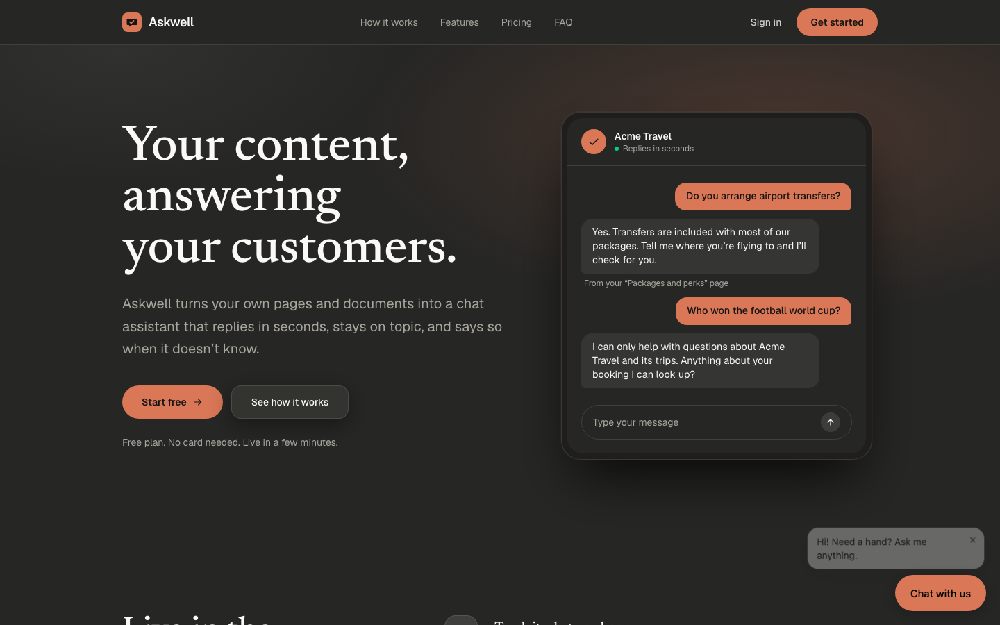
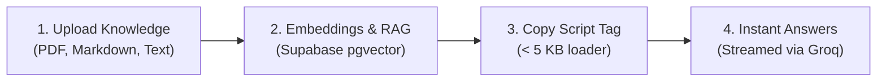

<div align="center">

# 💬 Askwell

**Embeddable AI customer support chat widget for any website.**  
*Upload your product documentation or PDFs, copy a single `<script>` tag, and deploy an intelligent, hallucination-free AI support agent in seconds.*

[](https://nextjs.org/)
[](https://react.dev/)
[](https://www.typescriptlang.org/)
[](https://supabase.com/)
[](https://groq.com/)
[](https://arcjet.com/)
[](https://clerk.com/)

[🌐 Live Demo](https://askwell.novitasweb.works) • [📖 Documentation](#-widget-integration) • [🚀 Getting Started](#-getting-started) • [🏗️ Architecture](#️-architecture)

<br/>



<br/>

---

</div>

## 🌟 Overview

**Askwell** bridges the gap between static documentation and real-time visitor assistance. Instead of forcing users to navigate complex knowledge bases or wait hours for human live-chat agents, Askwell answers questions instantly by grounding every response in your actual business content.

### Why Askwell?

- **⚡ Featherweight Footprint:** The loader bundle is **< 5 KB**, boots in milliseconds, and avoids degrading Core Web Vitals or slowing down host pages.
- **🎯 Grounded RAG (Zero Hallucinations):** Strict retrieval-augmented generation ensures answers only cite uploaded PDFs, Markdown docs, or text snippets.
- **🚀 Sub-Second Streaming:** Powered by Groq and the Vercel AI SDK for near-instant responses.
- **🛡️ Built-in AI Security:** Protected by **Arcjet** for real-time prompt injection defense, rate limiting, and bot protection.
- **🎨 Brand Customization:** Tailor colors, greeting messages, widget placement, and toggle branding badges.
- **💳 Built-in Subscription Flow:** Out-of-the-box billing and quota management powered by Cashfree (UPI Autopay, cards, eNACH).

---

## ⚡ How It Works



1. **Teach it your product:** Upload your knowledge docs, FAQs, or manuals in the dashboard.
2. **Embed the widget:** Paste a single script tag into any HTML, Next.js, WordPress, or Shopify site.
3. **Engage visitors 24/7:** Visitors get fast, friendly, source-backed answers to tier-1 questions while you review conversation logs in real time.

---

## 🏗️ Architecture & Monorepo Layout

Askwell is organized as a performant TypeScript monorepo powered by `pnpm`:

```
askwell/
├── apps/
│   └── web/                   # Next.js 16 App Router application
│       ├── app/               # Landing page, dashboard, auth, & API routes
│       │   ├── (dashboard)/   # Owner dashboard (projects, knowledge, analytics)
│       │   ├── (site)/        # Marketing site & interactive playground
│       │   ├── api/           # Vector search, chat completions, webhooks
│       │   └── embed/         # Sandboxed iframe widget UI
│       ├── components/        # Reusable UI & design system
│       ├── lib/               # Supabase clients, Arcjet, Groq, RAG pipeline
│       └── public/
│           └── widget.js      # Production vanilla JS widget loader (< 5 KB)
├── packages/
│   ├── db/                    # Supabase schema, migrations, pglite tests, types
│   └── shared/                # Shared constants, types, plan limits, & validation
└── supabase/
    └── migrations/            # Version-controlled SQL migrations & RLS policies
```

### Core Tech Stack

| Domain | Technology | Description |
| :--- | :--- | :--- |
| **Framework** | Next.js 16 (App Router) + React 19 | Server Components, streaming SSR, and edge/node routes |
| **Styling** | Tailwind CSS v4 | High-performance modern CSS styling |
| **Database** | Supabase Postgres + `pgvector` | Vector similarity search via stored SQL procedures (`rpc()`) |
| **Auth** | Clerk | Authentication with native JWT tokens passed to Supabase RLS |
| **AI / RAG** | Groq (`llama-3.3-70b-versatile`) + Ollama | Ultra-low latency chat completions + embeddings |
| **Security** | Arcjet | Token-bucket rate limiting and prompt injection shields |
| **Payments** | Cashfree Payments | Hosted subscription checkout & webhook verification |
| **Analytics** | PostHog | Telemetry, product analytics, and AI tracing |

---

## 🚀 Getting Started

### Prerequisites

- **Node.js** (v20+ recommended)
- **pnpm** (`npm install -g pnpm`)

### 1. Clone the repository

```bash
git clone https://github.com/novitas-webworks/askwell.git
cd askwell
```

### 2. Install dependencies

```bash
pnpm install
```

### 3. Configure environment variables

Create an `.env.local` file inside `apps/web/` (or copy from `.env.example`):

```bash
cp .env.example apps/web/.env.local
```

Key environment variables:

```ini
# Supabase
NEXT_PUBLIC_SUPABASE_URL=https://your-project.supabase.co
NEXT_PUBLIC_SUPABASE_PUBLISHABLE_KEY=your-supabase-publishable-key
SUPABASE_SECRET_KEY=your-supabase-secret-key

# Clerk Auth
NEXT_PUBLIC_CLERK_PUBLISHABLE_KEY=pk_test_...
CLERK_SECRET_KEY=sk_test_...

# AI Models (Groq + Ollama)
GROQ_API_KEY=gsk_...
GROQ_CHAT_MODEL=llama-3.3-70b-versatile
OLLAMA_BASE_URL=https://your-ollama-host
OLLAMA_API_KEY=your-ollama-bearer-key

# Security (Arcjet)
ARCJET_KEY=ajkey_...

# Payments (Cashfree)
CASHFREE_APP_ID=your_cashfree_app_id
CASHFREE_SECRET_KEY=your_cashfree_secret_key
CASHFREE_ENV=sandbox
CASHFREE_WEBHOOK_SECRET=your_webhook_secret

# Application
NEXT_PUBLIC_APP_URL=http://localhost:3000
```

### 4. Start the development server

```bash
pnpm dev
```

Visit [http://localhost:3000](http://localhost:3000) in your browser.

---

## 📖 Widget Integration

Adding Askwell to any website requires just one HTML tag before the closing `</body>` tag:

```html
<!-- Askwell AI Chat Widget -->
<script 
  src="https://askwell.novitasweb.works/widget.js" 
  data-key="pk_your_project_publishable_key"
  defer>
</script>
```

### Framework Examples

#### Next.js (App Router)
```tsx
import Script from "next/script";

export default function RootLayout({ children }: { children: React.ReactNode }) {
  return (
    <html lang="en">
      <body>
        {children}
        <Script
          src="https://askwell.novitasweb.works/widget.js"
          data-key="pk_your_project_publishable_key"
          strategy="lazyOnload"
        />
      </body>
    </html>
  );
}
```

#### Plain HTML / Webflow / WordPress / Shopify
Paste the script snippet directly into the custom code header/footer or site settings.

---

## 🧪 Testing & Code Quality

Run tests, type checks, and linting across the monorepo:

```bash
# Run unit and integration tests (Vitest + pglite for Postgres)
pnpm test

# Run TypeScript typechecks across all workspaces
pnpm typecheck

# Run ESLint across all workspaces
pnpm lint

# Build both web application and widget loader
pnpm build
```

---

## 🛡️ Security & Privacy

- **Row Level Security (RLS):** All database operations leverage Supabase RLS policies tied to the user's Clerk ID.
- **Client/Server Isolation:** The widget operates using a public publishable key (`pk_...`) restricted to conversational endpoints.
- **Prompt Injection Defense:** Every incoming message passes through Arcjet filters before executing any LLM inference.
- **Document Isolation:** Multitenancy is enforced at the database level; vector similarity matches strictly filter by `project_id`.

---

## 📄 License

This project is private and proprietary. Developed by **[Novitas WebWorks](https://novitasweb.works)**. All rights reserved.
